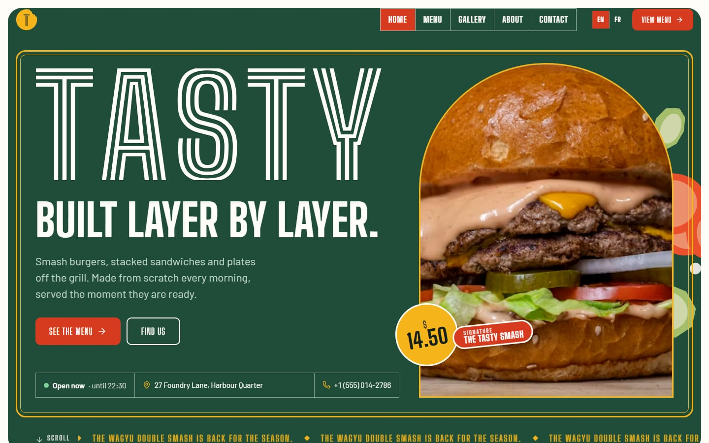
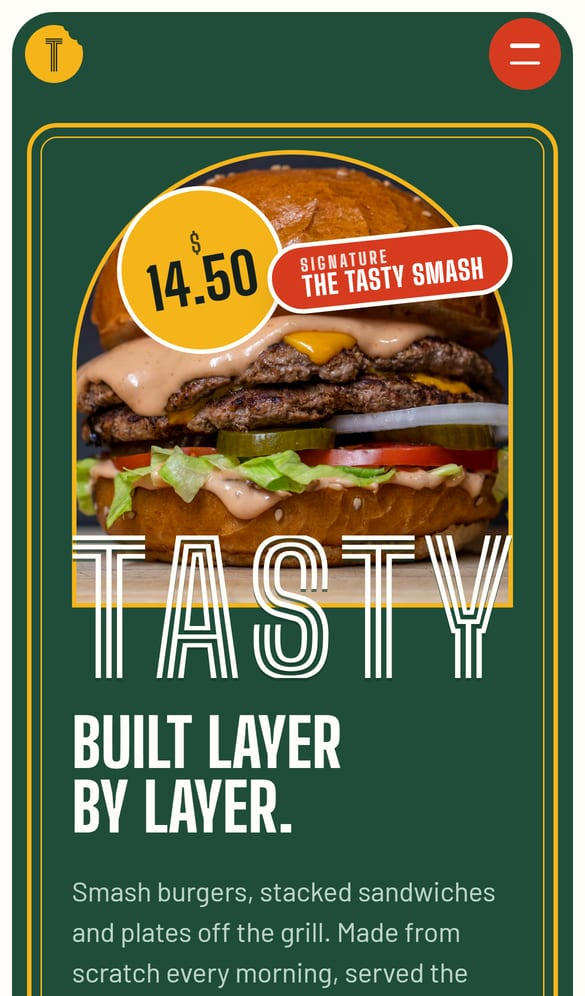
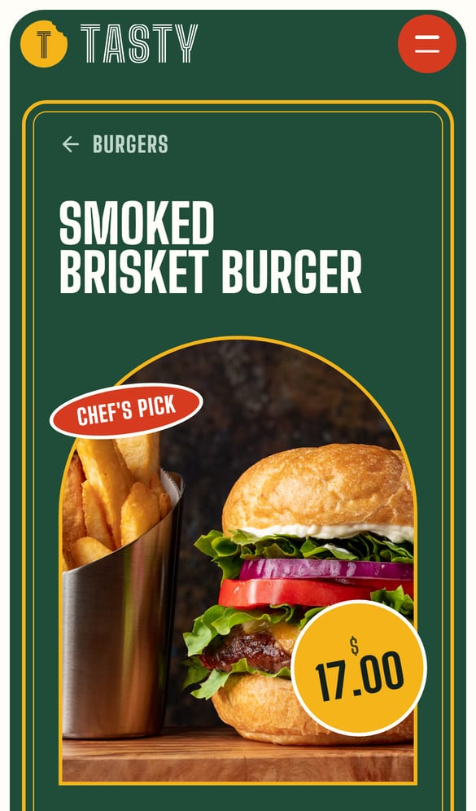
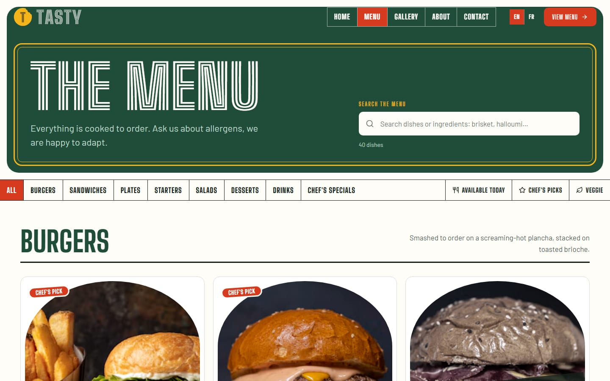
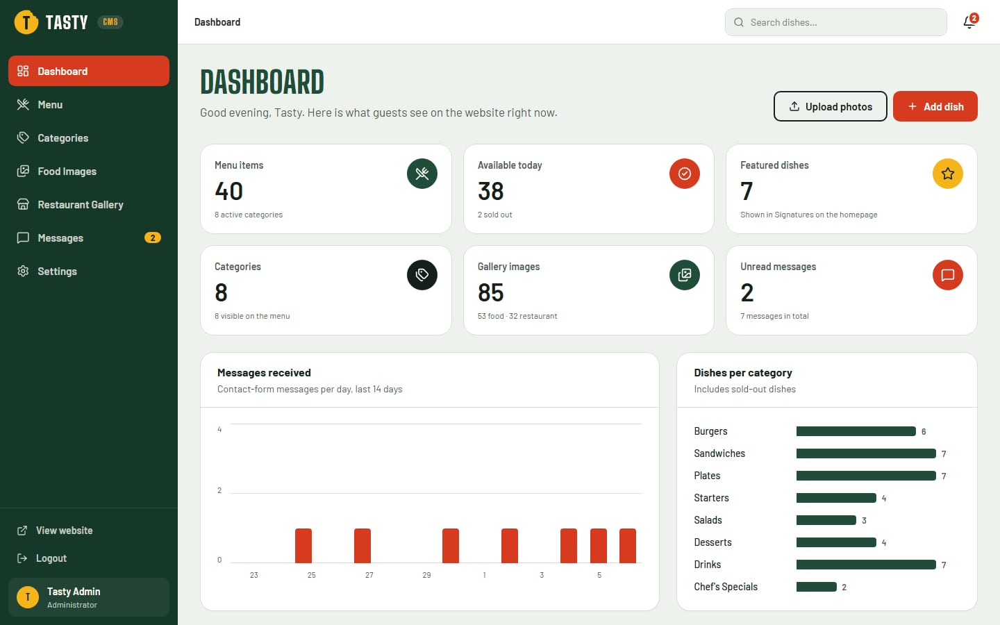

# Tasty: restaurant website & CMS

> **Portfolio showcase, not open source.** © 2026 Onority, all rights reserved. You're welcome to read the code, but you may not copy, reuse, deploy or sell it without written permission. See [LICENSE](LICENSE).

A complete platform for **Tasty**, a premium-casual burger, sandwich and grill kitchen. It has two parts:

- a bilingual (English / French) public website with an immersive homepage, digital menu, dish pages, galleries, about and contact pages;
- an admin dashboard (CMS) where the team manages dishes, categories, photography, contact messages and restaurant details.

Everything is real end to end: **React → REST API → Spring Boot → JPA / Hibernate → PostgreSQL**. Admin changes go live on the website immediately.

> All restaurant data shipped with the project is **demo content**: a fictional city ("Port Aurelle"), demo prices and Unsplash placeholder photography. Replace it from the admin. Nothing in the code needs to change.



<p>
  
  
</p>





---

## Contents

1. [Features](#features)
2. [Technology](#technology)
3. [Architecture](#architecture)
4. [Requirements](#requirements)
5. [Quick start with Docker](#quick-start-with-docker)
6. [Local development](#local-development)
7. [Environment variables](#environment-variables)
8. [Database & Flyway](#database--flyway)
9. [Demo credentials](#demo-credentials)
10. [API & Swagger](#api--swagger)
11. [Image storage](#image-storage)
12. [Brand identity](#brand-identity)
13. [Project structure](#project-structure)
14. [Testing](#testing)
15. [Production build & deployment](#production-build--deployment)
16. [License](#license)

---

## Features

**Public website** (`/`, `/menu`, `/menu/category/:slug`, `/menu/:slug`, `/gallery`, `/gallery/restaurant`, `/about`, `/contact`; French under `/fr/...`)

- Splash screen (first visit per session, ≤ 2.2 s), cinematic hero with GSAP timeline, Three.js ingredient scene (lazy-loaded, off under reduced motion, lighter on phones)
- Signatures carousel pinned with ScrollTrigger, editorial gallery, parallax, sticky storytelling, page transitions (Framer Motion)
- Digital menu from PostgreSQL: grouped "printed card" view, category cells, search by name / description / ingredients in both languages, filters (available, chef's picks, veggie), animated reflow, empty states
- Dish detail pages with photo switcher, ruled fact table, related dishes, JSON-LD
- Food & restaurant galleries in an editorial masonry rhythm with a keyboard/swipe lightbox
- Contact form validated in the browser and by the API, stored in PostgreSQL, rate limited, honeypot against bots
- Opening hours with live "open now", address, socials, chef's special and announcement ticker, all from admin → Settings
- SEO: per-page titles and descriptions, canonical + hreflang, Open Graph, JSON-LD (Restaurant, MenuItem), sitemap and robots

**Admin** (`/admin`)

- JWT sign-in (BCrypt passwords), protected routes, automatic sign-out on expiry, roles: **ADMIN** (everything) and **EDITOR** (everything except restaurant settings)
- Dashboard: stat tiles, messages-per-day and dishes-per-category charts, recent dishes and messages
- Menu CRUD with EN/FR fields, ingredients, main + additional photos, availability / featured / veggie / spicy, inline toggles, search, filters, sorting, pagination, unsaved-changes guard
- Category CRUD; a category with dishes can only be deleted after moving its dishes to another category
- Food Images & Restaurant Gallery: upload, replace, feature, assign to a dish, delete, filters, pagination
- Messages inbox: new / read / archived, search, mark read/unread, archive, delete, reply by email, notification bell
- Settings: restaurant profile, contact, location, socials, weekly hours (overnight closing supported), announcement, chef's special, currency; password change

---

## Technology

| Layer | Stack |
|---|---|
| Frontend | React 19, TypeScript 7, Vite 8, Tailwind CSS 4, Framer Motion, GSAP + ScrollTrigger, Three.js + React Three Fiber, React Router 8, Axios, Lucide icons, Fontsource (self-hosted fonts) |
| Backend | Java 21, Spring Boot 4.1 (Web MVC, Security, Data JPA / Hibernate 7, Validation, Actuator), JWT (jjwt), Lombok, springdoc OpenAPI |
| Database | PostgreSQL 18, Flyway migrations |
| Tests | JUnit 6, Spring MockMvc, Testcontainers (PostgreSQL); Vitest + Testing Library |
| Ops | Docker, Docker Compose, Nginx |

---

## Architecture

```text
tasty/
├── backend/     Spring Boot REST API (controllers → services → repositories, DTOs, mappers)
├── frontend/    React SPA (public website + admin)
├── brand/       Logo/favicons generator and the brand guide (BRAND.md)
├── docker-compose.yml
└── .env.example
```

```text
Browser ──► React (services/*.ts, Axios) ──► /api ──► Spring Boot controllers
                                                         │
                                         services (business rules, validation)
                                                         │
                                       JPA repositories ──► PostgreSQL (Flyway)
                                                         │
                                     ImageStorageService ──► local disk / S3 / Cloudinary / R2
```

- **Controllers** only translate HTTP ↔ DTOs; business rules live in **services**.
- Every response uses one envelope: `{ "success": true, "data": …, "message": "Success" }` or `{ "success": false, "message": "…", "errors": [{ "field": "…", "message": "…" }] }`.
- A global exception handler maps validation, not-found, conflicts, auth, upload and database errors to proper status codes and never leaks stack traces.

---

## Requirements

- **Docker** (Docker Desktop) for the quick start and the backend integration tests
- For local development: **Java 21+** (tested on 25), **Node.js 24.15+ / 22.13+**, PostgreSQL 16+ (or the Docker one)

---

## Quick start with Docker

```bash
cp .env.example .env
docker compose up -d
```

This starts **PostgreSQL** and the **API** on <http://localhost:8080> in the `dev` profile, with demo data. To also serve the production frontend through Nginx on <http://localhost:8081>:

```bash
docker compose --profile web up -d --build
```

Stop everything with `docker compose down`, and add `-v` to also delete the database and uploads volumes.

> If PostgreSQL is already installed locally on port 5432, set `POSTGRES_PORT=5433` in `.env`.

---

## Local development

**1. Database**

```bash
docker compose up -d postgres
```

**2. Backend** (http://localhost:8080, dev profile with demo data)

```bash
cd backend
./mvnw spring-boot:run
```

On Windows use `mvnw.cmd spring-boot:run`. If your database is not on `localhost:5432`, export `DATABASE_URL`, e.g. `DATABASE_URL=jdbc:postgresql://localhost:5433/tasty`.

**3. Frontend** (http://localhost:5173)

```bash
cd frontend
npm install
npm run dev
```

Vite proxies `/api` and `/uploads` to the backend, so everything runs on one origin. Open <http://localhost:5173> for the website and <http://localhost:5173/admin> for the dashboard.

| Command | What it does |
|---|---|
| `npm run dev` | Vite dev server with hot reload |
| `npm run build` | Type-check (tsc) and production build into `frontend/dist` |
| `npm run preview` | Serve the production build locally (port 4173, API proxied) |
| `npm test` | Vitest test suite |
| `./mvnw spring-boot:run` | Run the API |
| `./mvnw test` | Backend unit + integration tests (needs Docker) |
| `./mvnw package` | Build `backend/target/tasty-api-1.0.0.jar` |

---

## Environment variables

See `.env.example` for the full list. The important ones:

| Variable | Purpose | Default (dev) |
|---|---|---|
| `DATABASE_URL` | JDBC URL | `jdbc:postgresql://localhost:5432/tasty` |
| `DATABASE_USERNAME` / `DATABASE_PASSWORD` | Database credentials | `tasty` / `tasty` |
| `JWT_SECRET` | HMAC key, ≥ 32 bytes. **Required in production** (placeholders are refused) | dev-only fallback |
| `JWT_EXPIRATION` | Token lifetime (`12h`, `30m`, …) | `12h` |
| `ADMIN_EMAIL` / `ADMIN_PASSWORD` | Creates the first administrator at startup if missing | (empty) |
| `UPLOAD_DIRECTORY` | Where uploaded images are written | `./uploads` |
| `UPLOAD_PUBLIC_BASE_URL` | URL prefix for uploads (`/uploads` or an absolute CDN/API URL) | `/uploads` |
| `FRONTEND_URL` | Public site URL | `http://localhost:5173` |
| `CORS_ALLOWED_ORIGINS` | Comma-separated browser origins allowed to call the API | `http://localhost:5173,…` |
| `SPRING_PROFILES_ACTIVE` | `dev` or `prod` | `dev` |
| `SWAGGER_ENABLED` | Expose Swagger UI in production | `false` |
| `VITE_API_URL` | Frontend build: API base (`/api` when proxied, else absolute) | `/api` |

Never commit `.env`.

---

## Database & Flyway

The schema is owned by **Flyway**; Hibernate only validates it (`ddl-auto: validate`).

| Migration | Content |
|---|---|
| `V1__create_users.sql` | Staff accounts (BCrypt hashes, roles) |
| `V2__create_categories.sql` | Menu categories (EN/FR, display order, active) |
| `V3__create_menu_items.sql` | Dishes, `ON DELETE RESTRICT` to categories |
| `V4__create_menu_item_images.sql` | Additional dish photos, `ON DELETE CASCADE` |
| `V5__create_gallery_images.sql` | Food & restaurant photography, optional dish link |
| `V6__create_contact_messages.sql` | Contact-form messages and their status |
| `V7__create_restaurant_settings.sql` | Restaurant profile and weekly opening hours (neutral defaults) |
| `db/demo/V7_1__insert_demo_data.sql` | **Development only**: 8 categories, 40 dishes, 85 photos, messages, demo profile, dev accounts |

Demo data lives in a separate location (`classpath:db/demo`) that only the **dev** profile loads. The **prod** profile starts with an empty, production-ready schema. Admin-managed tables record `created_at` / `updated_at` and `created_by` / `updated_by` automatically.

To reset the development database: `docker compose down -v && docker compose up -d`.

---

## Demo credentials

**Development only.** These accounts are created by the demo migration, which the production profile never runs.

| Role | Email | Password |
|---|---|---|
| Admin | `admin@tasty.local` | `Admin123!` |
| Editor | `editor@tasty.local` | `Editor123!` |

In production, create the first administrator with `ADMIN_EMAIL` and `ADMIN_PASSWORD` (≥ 10 characters). Passwords are stored as BCrypt hashes (cost 12).

---

## API & Swagger

Interactive documentation: <http://localhost:8080/swagger-ui.html> (OpenAPI JSON at `/v3/api-docs`). Sign in with `POST /api/auth/login`, copy the token and press **Authorize**.

| Area | Endpoints |
|---|---|
| Auth | `POST /api/auth/login` · `GET /api/auth/me` · `PUT /api/auth/password` |
| Categories | `GET /api/categories` · `GET /api/categories/{id}` · `GET /api/categories/slug/{slug}` · `POST` · `PUT /{id}` · `DELETE /{id}?reassignTo=` |
| Menu | `GET /api/menu?q=&category=&categoryId=&available=&featured=&vegetarian=&spicy=&sort=&page=&size=` · `GET /api/menu/{id}` · `GET /api/menu/slug/{slug}` · `POST` · `PUT /{id}` · `PATCH /{id}/status` · `DELETE /{id}` |
| Gallery | `GET /api/gallery?group=&category=&featured=&menuItemId=&q=&page=&size=` · `GET /{id}` · `POST` · `PUT /{id}` · `DELETE /{id}` |
| Images | `POST /api/images` (multipart `file`, `folder`) · `DELETE /api/images?key=` |
| Contact | `POST /api/contact` (public) |
| Messages | `GET /api/messages?status=&q=&page=&size=` · `GET /unread` · `GET /{id}` · `PUT /{id}/read` · `PUT /{id}/unread` · `PUT /{id}/archive` · `DELETE /{id}` |
| Dashboard | `GET /api/dashboard` |
| Settings | `GET /api/settings` (public) · `PUT /api/settings` (ADMIN) |

`GET` endpoints for the public website are open. Everything else requires a staff JWT; `PUT /api/settings` requires `ADMIN`. Lists are paginated (`page`, `size` ≤ 100). Guests never receive dishes from hidden categories. Login and contact submissions are rate limited per client.

---

## Image storage

```text
ImageStorageService          upload() · delete() · replace() · getUrl()
└── LocalImageStorageService  /uploads/menu · /uploads/gallery · /uploads/restaurant · /uploads/team
```

- Uploads are validated three ways: **MIME type, file extension and the file's actual signature** (JPEG, PNG, WebP, AVIF), plus a size limit (8 MB by default).
- The admin uploads first (`POST /api/images`), then saves the dish or photo with the returned `url` and `storageKey`. When a record is updated or deleted, files it no longer references are removed **after the database transaction commits**. Abandoned uploads from cancelled forms are cleaned up as well.
- To move to **Cloudinary, AWS S3 or Cloudflare R2**: implement `ImageStorageService` (for example `S3ImageStorageService`), annotate it `@ConditionalOnProperty(prefix = "tasty.storage", name = "type", havingValue = "s3")`, set `STORAGE_TYPE=s3` and `UPLOAD_PUBLIC_BASE_URL` to the bucket/CDN URL. Nothing else changes.
- **Placeholder photos** are stored as absolute Unsplash URLs in the database. Replace them by uploading Tasty's photography in the admin. Image URLs are never hard-coded in components.

---

## Brand identity

The identity (Crate Label direction: bitten-sticker mark, inline wordmark, condiment inks, Big Shoulders + Barlow) is documented in **[brand/BRAND.md](brand/BRAND.md)**. Logo files are in `frontend/public/brand/`. To regenerate logos, favicons and the social card:

```bash
cd brand
npm install
npm run build
```

The build also writes `brand/brand-sheet.png` (a review sheet), and every raster it renders carries a short provenance note in its metadata (a PNG `tEXt` chunk or a JPEG comment) saying how it was made.

`DESIGN.md` records the built design system (tokens, components, layout rules) for future work, and `PRODUCT.md` records the product context.

---

## Project structure

```text
backend/src/main/java/com/tasty/
├── controller/   REST controllers (Auth, Category, Menu, Gallery, Image, Contact, Message, Dashboard, Settings)
├── service/      Business logic, rate limiting, after-commit image cleanup
├── repository/   Spring Data repositories + JPA Specifications (spec/)
├── entity/       JPA entities with auditing base classes
├── dto/          Request/response records grouped by feature
├── mapper/       Entity ↔ DTO mappers
├── security/     JWT service + filter, user details, JSON 401/403 handlers
├── exception/    API exceptions + global exception handler
├── config/       Security, CORS, OpenAPI, auditing, storage, bootstrap admin, prod safety check
├── storage/      ImageStorageService abstraction, local implementation, file validator
├── validation/   Custom constraints (@ImageUrl)
└── util/         Slugs, CSV lists, paging, text helpers
backend/src/main/resources/
├── application.yml, application-dev.yml, application-prod.yml
└── db/migration (V1–V7), db/demo (V7_1 demo data)

frontend/src/
├── api/          Axios clients, error normalisation, envelope unwrapping
├── services/     authService, menuService, categoryService, galleryService, imageService,
│                 messageService, contactService, settingsService, dashboardService
├── types/        API and domain types
├── hooks/        useQuery (cached fetching), media queries, debounce, open status, upload cleanup…
├── context/      Auth, settings, intro (splash) providers
├── i18n/         EN/FR dictionaries and locale helpers
├── animations/   GSAP registration, scroll reveal/parallax hooks, Framer Motion variants
├── components/   ui/ (design system) · public/ · home/ · menu/ · admin/ · brand/ · three/
├── layouts/      RootLayout, PublicLayout, AdminLayout
├── pages/        public/ and admin/ pages (lazy-loaded)
├── router/       Route table, auth guard, error boundary
├── styles/       Tailwind theme tokens and base styles
├── utils/        Formatting, images, hours, validation, structured data
└── test/         Test setup and helpers
```

---

## Testing

**Backend:** `cd backend && ./mvnw test`. **44 tests**: authentication, authorization (roles, invalid tokens), category / menu / gallery CRUD, validation, uploads (type, extension, signature, size, folder), file cleanup, contact form and message workflow, plus unit tests for JWT, slugs and file validation. Integration tests run against a real PostgreSQL in Testcontainers (Docker required) with the real Flyway migrations.

**Frontend:** `cd frontend && npm test`. **16 tests**: admin login (validation, success, wrong credentials), creating, editing and deleting a dish, category creation and delete-with-reassignment, image upload and rejection, gallery photo deletion, public menu rendering, filtering, search and the French menu.

---

## Production build & deployment

1. Set real values in `.env`: `SPRING_PROFILES_ACTIVE=prod`, a strong `JWT_SECRET`, database credentials, `ADMIN_EMAIL` / `ADMIN_PASSWORD`, `CORS_ALLOWED_ORIGINS` and `FRONTEND_URL` for your domain.
2. Build and start: `docker compose --profile web up -d --build`.
3. Put a TLS-terminating reverse proxy (Caddy, Traefik, a cloud load balancer) in front of the `frontend` container (port 80 inside, `FRONTEND_PORT` outside), have it send `X-Forwarded-Proto: https`, and add `Strict-Transport-Security` there. Nginx already proxies `/api` and `/uploads` to the backend:
   - It forwards the public `Host` and `X-Forwarded-*` headers, so the API treats requests from the site as same-origin (no CORS round trip).
   - It sends security headers on everything it serves: `nosniff`, `Referrer-Policy`, `X-Frame-Options: DENY`, `Permissions-Policy` and a Content-Security-Policy that allows only same-origin scripts, styles, fonts and API calls, plus HTTPS images. These live in `frontend/nginx/security-headers.conf`; if `VITE_API_URL` points at another origin, add it to `connect-src` and `img-src` there.
4. Persist the `postgres-data` and `uploads` volumes (or switch storage to S3/R2), and back up PostgreSQL regularly (`pg_dump`).
5. Readiness/liveness: `GET /actuator/health/readiness` and `/actuator/health/liveness` on the backend.
6. Update `frontend/public/sitemap.xml` and `robots.txt` with the production domain.

Alternatively, deploy the frontend `dist/` to any static host (Netlify, Vercel, S3 + CloudFront) with SPA fallback, and build it with `VITE_API_URL=https://api.your-domain.com/api`, `CORS_ALLOWED_ORIGINS` set accordingly and `UPLOAD_PUBLIC_BASE_URL=https://api.your-domain.com/uploads`.

**Production profile behaviour:** no demo data, Swagger off unless `SWAGGER_ENABLED=true`, quieter logging, startup refused if the JWT secret is missing, too short or still a placeholder.

---

## License

© 2026 Onority. All rights reserved. This project is published as a portfolio showcase: you may read the code on GitHub, but you may not copy, reuse, deploy or sell it without written permission. Third-party libraries, fonts and placeholder photos keep their own licenses. See [LICENSE](LICENSE) for the full terms.
